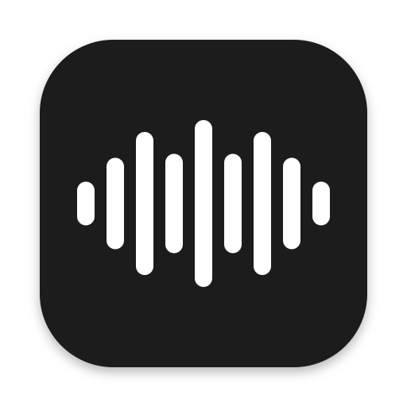

<p align="center">
  
</p>

<h1 align="center">Vello</h1>

<p align="center">Free, private, on-device dictation for macOS. Hold a key, speak, let go: your words are typed wherever your cursor is.</p>

<p align="center"><a href="https://github.com/alimuratkuslu/vello/releases/latest"><b>Download for Mac</b></a></p>

- **Runs on your Mac.** Speech recognition is local (Whisper large-v3 turbo via [WhisperKit](https://github.com/argmaxinc/argmax-oss-swift)). No account, no cloud, no subscription. Works offline after the first launch.
- **Fast.** Speech is transcribed in the background while you talk, so even a one-minute dictation is typed about a second after you let go.
- **Mixed language friendly.** Built for speaking Turkish with English technical words, and works in any language Whisper supports.
- **Lightweight.** Lives in the menu bar, no Dock icon.

[Türkçe](#türkçe)

## Install

With [Homebrew](https://brew.sh):

```sh
brew install --cask alimuratkuslu/tap/vello
```

Or download `Vello-x.y.z.dmg` from [Releases](../../releases/latest) and drag Vello to Applications.

Then open Vello and follow the setup window: pick your speaking language and talk key, allow Microphone and Accessibility. The speech model (~600 MB) downloads once in the background; a card tells you when it's ready. Hold **Right Option** (or the key you picked), speak, release.

Vello updates itself: it checks for new versions daily and asks before installing.

Requires macOS 14 or later on Apple Silicon.

## Privacy

Your voice never leaves your Mac. Recording happens only while you hold the talk key, transcription runs on-device, and nothing is stored or sent anywhere. Vello connects to the internet only to download the speech model once and to check GitHub for updates.

## Tips

- **Word list:** Settings → Word list. Add names and terms you use often; they come out spelled right more often. Keep it under ~40 words, longer lists slow typing down.
- **AirPods:** with the microphone on *Automatic*, Vello records from the MacBook mic while AirPods are connected, so your music isn't degraded and the first word isn't cut off.
- **In calls:** Vello works during Zoom, Meet, Teams or Slack calls, but the people on the call hear you dictating unless you mute yourself there.
- **Settings:** open Vello again from Launchpad or Finder, or use the menu bar icon → Settings.
- **Feedback:** menu bar icon → Send Feedback… opens a GitHub issue with your versions filled in.

## Türkçe

Vello, macOS için ücretsiz ve tamamen cihaz üzerinde çalışan bir dikte uygulaması. Tuşu basılı tut, konuş, bırak: söylediklerin imlecin olduğu yere yazılır.

- Ses tanıma tamamen Mac'inde çalışır; hesap, bulut veya abonelik yok. İlk açılıştan sonra internetsiz çalışır.
- Konuşurken arka planda çevirir; bir dakikalık Dikte bile tuşu bıraktıktan yaklaşık bir saniye sonra yazılır.
- Türkçe içinde İngilizce teknik kelimelerle konuşmak için tasarlandı.

**Kurulum:** `brew install --cask alimuratkuslu/tap/vello` ya da [Releases](../../releases/latest) sayfasından `Vello-x.y.z.dmg` dosyasını indirip Vello'yu Uygulamalar klasörüne sürükle. Sonra aç ve kurulum penceresini takip et. Vello kendini günceller. macOS 14+ ve Apple Silicon gerekir.

**Gizlilik:** Sesin Mac'inden hiç çıkmaz. Yalnızca tuş basılıyken kaydedilir, cihazda yazıya çevrilir, hiçbir yere kaydedilmez veya gönderilmez. Vello internete yalnızca ses modelini bir kez indirmek ve güncellemeleri kontrol etmek için bağlanır.

**Görüşmelerde:** Zoom, Meet, Teams veya Slack görüşmesindeyken de çalışır; ama kendini oradan sessize almazsan karşı taraf dikte ettiklerini duyar.

## License

MIT. See [LICENSE](LICENSE).
